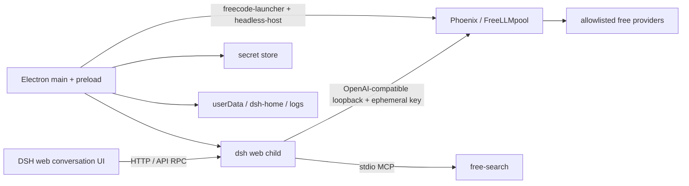

# Architecture

FreeCode DeepSeek Harness v1.0.1 is a Windows x64 Electron shell around the
upstream DeepSeek Harness web application. The shell owns native lifecycle, the
local Phoenix model gateway, secrets, model discovery, MCP configuration,
packaging and tray/UI affordances. Phoenix is pinned FreeLLMpool 0.13.0, shipped
as a Windows x64 executable with its MIT license, exact model allowlist and
source/build receipt. It requires no machine-installed Python, `C:\LocalAI`,
separate FreeLLMpool service or fixed gateway port. The upstream subtree owns
the agent runtime and conversation web product. v1.0.1 is an unpublished source
candidate; see the [bilingual candidate notes](../release-notes-v1.0.1.md).



## Runtime sequence

Before startup, the packaged app validates the separate DSH runtime in
`<userData>/harness-runtime`. A launch without a valid cache downloads the
exact pinned Windows x64 DSH `0.2.1-alpha.11` public asset, verifies SHA-256,
Electron ABI and Node engine range, then activates it before preflight or
supervisor startup. Phoenix itself ships in the desktop package and is
validated locally; it is not downloaded or built on the user's machine.
Existing valid DSH runtimes need no network access on later launches; download
or compatibility failures remain visible and retryable.

1. Electron resolves development resources or packaged `resources/freecode`.
2. The shell verifies Phoenix's x64 PE architecture, source/build receipt,
   model allowlist, license and SHA-256 before creating a private state folder.
3. `freecode-launcher` starts the bundled Phoenix executable hidden through
   the verified `headless-host` helper on an OS-assigned loopback port. The
   shell supplies an ephemeral API key, polls `/healthz` with a bound, and owns
   its restart/stop lifecycle. It never takes over a port or external process.
4. The shell seeds DSH's single managed provider to the local Phoenix URL and
   private key. Refresh synthesizes Auto Phoenix first, then keeps the
   source-controlled quality order of the verified concrete allowlist; probe
   latency cannot invert that order. The generated Kilo slice contains only
   direct no-auth non-Nemotron routes and excludes dynamic Kilo aliases.
   Production probes every candidate with a chat completion; only a parseable,
   non-empty HTTP 200 completion from the current refresh remains selectable.
   Timeouts/transport errors, HTTP errors and empty/malformed 200 responses
   remove the model immediately. Prior success is diagnostic only; a later
   successful probe restores the model.
   The exact packaged registry remains configured independently of selector
   eligibility (`selectable: false`); a health refresh cannot invalidate the
   next step of a pinned turn or erase its context/effort metadata. Auto has a
   4,096-token compaction headroom/summary policy for its conservative 32K cap.
   Failed summarization preserves history; Auto routing forwards the full
   prepared messages and tool results without truncation on failover.
5. The supervisor starts `dsh web --host 127.0.0.1 --port 0 --no-open` with a
   whitelisted environment and waits for its authenticated readiness URL.
6. The shell opens one hardened `BrowserWindow` with context isolation, no Node
   integration, renderer sandboxing and the preload bridge.
7. A concrete model choice stays pinned to that exact route; failure does not
   select another model. Auto alone may try another enabled free route before
   the first downstream stream byte. Once streaming begins, no model/provider
   change or retry occurs. Client errors do not poison route health.
8. The managed MCP catalog is materialized under `dsh-home/mcp/servers.json`.
   Standard mounts free-search (disabled until its binary is vendored) only
   when its persisted flag is enabled. Readiness requires
   `initialize → tools/list → schema validation → registration`.

## Process ownership and headless policy

- `apps/shell/src/main/index.ts`: Electron lifecycle, one native window, tray,
  menus, notifications, updater and logging.
- `apps/shell/src/main/runtime.ts`: Phoenix, DSH supervisor and MCP status
  composition.
- `apps/shell/src/main/phoenix-gateway.ts`: verified Phoenix startup,
  health/readiness, key isolation and contained restart/shutdown.
- `apps/shell/src/main/phoenix-payload.ts`: installed payload hash, provenance,
  architecture, license and model-allowlist validation.
- `apps/shell/src/main/port-allocator.ts`: loopback allocation; occupied ports
  are skipped, never taken over.
- `apps/shell/src/main/harness-supervisor.ts`: DSH readiness, generations,
  restart budget, tree termination and no-window child spawning.
- `packages/shared-types`: zod-backed IPC and runtime status contracts.
- `vendor/deepseek-harness`: upstream runtime and web client, kept as a subtree.
- `vendor/deepseek-harness/packages/mcp/mcp-client`: MCP initialization,
  schema discovery, project activation and classified tool-call bridge.
- `vendor/deepseek-harness/packages/llm/llm/src/ocr.ts`: bounded direct OCR
  helper used by text-only image paths.

All shell-owned background Windows process trees use `freecode-launcher` and
the verified GUI-subsystem `headless-host`; private-desktop creation and
suspended-process Job attachment are mandatory. Do not add a direct-spawn
fallback, environment opt-out or process-name window hider. Explicit user GUI
actions use the authenticated Electron broker. Packaging runs adversarial
native window/descendant and Job-lifetime tests against the exact helper. The
shell does not use `cmd.exe`, `start`, a terminal window or a browser to do
background work.

## MCP configuration and observability

The managed files are:

```text
<userData>/dsh-home/mcp/servers.json
<userData>/dsh-home/cordis.patch.yml
```

Settings → Plugins → MCP exposes toggles, live state, tool count, errors and
the config path. The tray shows enabled MCP servers that are ready. A failed
connection produces a native notification once per failure state and remains
visible in the tab and app log. The generated block is atomic and unrelated
user patch rows are preserved.

## Model-facing output compression

The Bash and Windows PowerShell providers expose independent RTK and Caveman
settings. Both schema toggles default to enabled; each wrapper is a no-op when
its executable is not installed. RTK remains optional and is never advertised
as used merely because its setting is enabled. Only eligible plain commands
are wrapped; pipes, redirects, substitutions and other shell syntax remain
unchanged. FreeCode does not silently install either external optimizer.

## OCR boundary

Windows packaging includes Tesseract and English trained data under
`resources/freecode/tesseract`. The helper receives a validated absolute image
path, bounded language/PSM arguments and a timeout. Image size, OCR output and
cache size are bounded; image bytes and OCR contents are never written to the
application log. Vision routes keep the image. Text-only routes receive OCR
text for both direct attachments and `read_image`, with explicit errors when
the helper is unavailable or returns empty/invalid output.

## Resource layout

```text
resources/freecode/
  phoenix/freellmpool-win-x64.exe
  phoenix/freecode-build-receipt.json
  phoenix/phoenix-model-ids.json
  phoenix/LICENSE
  tesseract/tesseract.exe
  tesseract/*.dll
  tesseract/tessdata/eng.traineddata
  dsh/apps/cli/lib/bin.js
  dsh/packages/**/node_modules/@deepseek-ai/*
  runtime-manifest.json
```

The complete workspace install is deliberate: production-only dependency
installation can leave upstream workspace links unresolved and make boot fail.
Portable builds place `data/` beside the executable. NSIS uses the normal
per-user Windows application data path.

## Security boundaries

- The renderer receives only `window.freecode` from the isolated preload.
- Secrets are read from the host vault and injected into child environments;
  they are not copied into global `process.env`. Phoenix receives a random
  per-run API key only in its contained child environment.
- Phoenix and DSH bind to `127.0.0.1` on OS-assigned ports; only the Phoenix
  process launched by the shell is supervised. Phoenix forwards requests to
  its allowlisted external providers, which receive request contents.
- MCP server arguments are arrays, not shell strings, and their stderr is
  bounded. Tool-call logs omit arguments and image data.
- OCR validates paths, size and output and does not log sensitive content.
- Upstream permission, sandbox, filesystem and confirmation policy remains
  authoritative. FreeCode does not silently widen sandbox access.
- The updater checks at startup and every six hours, uses an in-flight guard,
  and shows download/install progress through the tray and native notices.

## Upstream and modular patches

`vendor/deepseek-harness` is updated first. Product changes are then applied in
sorted `patches/upstream/*.patch` order by the idempotent, vendor-scoped patch
applier. The intended flow is:

```text
upstream fetch/subtree update
  → pnpm apply:upstream-patches
  → pnpm prepare:upstream
  → tests/typecheck/build/package
```

Patches are incremental: a later patch assumes earlier patches, never rewrites
the entire vendor tree, and must include a focused contract test. Direct vendor
edits are temporary working changes until represented by a patch. See
[`docs/UPSTREAM-PATCHING.md`](UPSTREAM-PATCHING.md).

## Windows release scope

v1.0.1 targets Windows x64 NSIS and portable artifacts only. This source
candidate is not yet packaged or published. Linux/macOS are contributor-only
manual builds and have no release gate, no binary upload and no claim of
parity. The local release gate is documented in [`docs/RELEASE.md`](RELEASE.md).
